<div align="center">


<br/><br/>

<a href="https://x0ph3nt.com"></a>
<a href="https://x.com/b4x0rn"></a>
<a href="https://tryhackme.com"></a>

</div>

---

## `$ whoami`

Offensive security practitioner focused on **Active Directory exploitation** and **red team tradecraft**. I build lab environments, break them methodically, and document the attack paths. Currently working toward **CRTP** and **OSCP**.

```yaml
handle:     b4x0rn
focus:      [active-directory, red-team, web-exploitation, linux-privesc]
certs:      [CAPT, AD-RTS, MCRTA, CRTA]
in_progress: CRTP
target:     OSCP
scripting:  [bash, python]
```

---

## 🧭 Methodology

```mermaid
flowchart LR
    A[Recon] --> B[Enumeration]
    B --> C[Initial Access]
    C --> D[Privilege Escalation]
    D --> E[Lateral Movement]
    E --> F[Domain Compromise]
    F --> G[Reporting]
    style A fill:#0d1117,stroke:#00ff9c,color:#c9d1d9
    style B fill:#0d1117,stroke:#00ff9c,color:#c9d1d9
    style C fill:#0d1117,stroke:#00ff9c,color:#c9d1d9
    style D fill:#0d1117,stroke:#00ff9c,color:#c9d1d9
    style E fill:#0d1117,stroke:#00ff9c,color:#c9d1d9
    style F fill:#0d1117,stroke:#00ff9c,color:#c9d1d9
    style G fill:#0d1117,stroke:#00ff9c,color:#c9d1d9
```



---

## ⚔️ Technical Focus

| Domain | Scope | Tooling |
|:--|:--|:--|
| **Active Directory** | Domain enumeration, attack-path analysis, credential abuse, lateral movement | `impacket` |
| **Web Application** | XSS, SQL injection, IDOR, content discovery, fuzzing | `burpsuite` · `ffuf` |
| **Network** | Host & service discovery, port scanning, service fingerprinting | `nmap` |
| **Linux** | Enumeration, privilege escalation, post-exploitation navigation | `bash` |
| **Cloud** | Cloud red team fundamentals (MCRTA) | — |
| **Automation** | Tooling and workflow scripting | `python` · `bash` |

<p>
  
  
  
  
  
  
  
</p>

---

## 📜 Certifications & Roadmap

| Status | Certification | Domain |
|:-:|:--|:--|
| ✅ | **CAPT** | Penetration testing (Hackviser) |
| ✅ | **AD-RTS** | Active Directory red team |
| ✅ | **MCRTA** | Cloud red team |
| ✅ | **CRTA** | Active Directory red team |
| 🔄 | **CRTP** | Active Directory red team (in preparation) |
| 🎯 | **OSCP** | Offensive security (target) |

---

## 📝 Research & Writeups

Technical writeups, lab notes, and attack-path breakdowns:

**[x0ph3nt.com](https://x0ph3nt.com)**

---

<div align="center">


</div>
