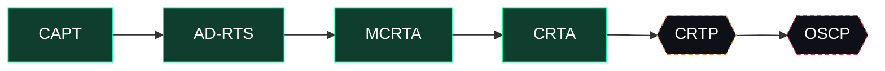

<div align="center">


<a href="https://x0ph3nt.com">
  
</a>

<br/><br/>

<a href="https://x0ph3nt.com"></a>
<a href="https://x.com/b4x0rn"></a>
<a href="https://tryhackme.com"></a>


<br/>


</div>

---

## 🖥️ `root@b4x0rn:~#`

```console
root@b4x0rn:~# whoami
b4x0rn

root@b4x0rn:~# cat profile.yml
role:        Offensive Security Practitioner
focus:       Active Directory · Red Team · Web · Linux Privesc
certified:   CAPT · AD-RTS · MCRTA · CRTA
in_progress: CRTP
next_target: OSCP
scripting:   Bash · Python
mindset:     Always improving. Always learning. No limits.

root@b4x0rn:~# ./status.sh
[+] Labs ............... running
[+] Writeups ........... publishing
[+] TryHackMe .......... Top 2%  →  chasing Top 1%
[+] Certification path . CRTP → OSCP
```

---

## 🧭 Methodology

```mermaid
flowchart LR
    A([🔎 Recon]) --> B([📡 Enumeration])
    B --> C([💥 Initial Access])
    C --> D([⬆️ Privilege Escalation])
    D --> E([🔀 Lateral Movement])
    E --> F([👑 Domain Compromise])
    F --> G([📝 Reporting])
    style A fill:#0d1117,stroke:#00ff9c,color:#c9d1d9
    style B fill:#0d1117,stroke:#00ff9c,color:#c9d1d9
    style C fill:#0d1117,stroke:#00ff9c,color:#c9d1d9
    style D fill:#0d1117,stroke:#00ff9c,color:#c9d1d9
    style E fill:#0d1117,stroke:#00ff9c,color:#c9d1d9
    style F fill:#0d1117,stroke:#00ff9c,color:#c9d1d9
    style G fill:#0d1117,stroke:#00ff9c,color:#c9d1d9
```



---

## ⚔️ Technical Focus

<table>
<tr>
<td width="50%" valign="top">

#### 🏰 Active Directory
Domain enumeration · attack-path analysis · credential abuse · lateral movement
`impacket`

#### 🌐 Web Application
XSS · SQL injection · IDOR · content discovery · fuzzing
`burpsuite` `ffuf`

</td>
<td width="50%" valign="top">

#### 🐧 Linux & Network
Service discovery · enumeration · privilege escalation
`nmap` `bash`

#### ☁️ Cloud & Automation
Cloud red team fundamentals (MCRTA) · tooling & workflow scripting
`python` `bash`

</td>
</tr>
</table>

---

## 🛠️ Toolkit

<div align="center">


<br/><br/>


</div>

<details>
<summary><b>⌨️ Daily-driver workflow (click to expand)</b></summary>

```bash
# 1. Recon: full TCP sweep, then targeted service scan
nmap -p- --min-rate 5000 -oN full.txt <target>
nmap -sC -sV -p <ports> -oN services.txt <target>

# 2. Web: content & vhost discovery
ffuf -u http://<target>/FUZZ -w <wordlist> -mc all -fc 404
ffuf -u http://<target>/ -H "Host: FUZZ.<domain>" -w <wordlist> -fs <size>

# 3. Active Directory: authenticated enumeration with Impacket
impacket-GetUserSPNs <domain>/<user>:<pass> -dc-ip <dc> -request
impacket-secretsdump <domain>/<user>:<pass>@<dc>
```

*Authorized targets and lab environments only.*

</details>

---

## 📜 Certifications & Roadmap

| Status | Certification | Domain |
|:-:|:--|:--|
| ✅ | **CAPT** | Penetration testing · Hackviser |
| ✅ | **AD-RTS** | Active Directory red team |
| ✅ | **MCRTA** | Cloud red team |
| ✅ | **CRTA** | Active Directory red team |
| 🔄 | **CRTP** | Active Directory red team · *in preparation* |
| 🎯 | **OSCP** | Offensive security · *target* |



---

## 📊 GitHub Analytics

<div align="center">


</div>

<!-- Optional: enable .github/workflows/snake.yml, then uncomment the block below
<div align="center">
<picture>
  <source media="(prefers-color-scheme: dark)" srcset="https://raw.githubusercontent.com/x0ph3nt/x0ph3nt/output/github-snake-dark.svg" />
  
</picture>
</div>
-->

---

## 📝 Research & Writeups

Attack-path breakdowns, lab notes, and technical writeups:

<div align="center">

### 🔗 [x0ph3nt.com](https://x0ph3nt.com)

</div>

---

## 🤝 Connect

<div align="center">

<a href="https://x.com/b4x0rn"></a>
<a href="https://x0ph3nt.com"></a>

<br/><br/>

```python
while True:
    learn(); practice(); break_things(); improve()
```

<!-- <sub>⚠️ For authorized testing and educational purposes only.</sub> -->


</div>
